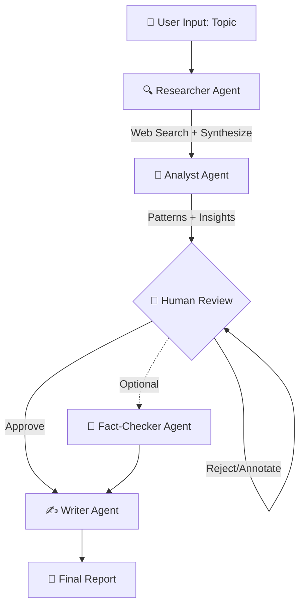

# 🔬 AgentResearch — Multi-Agent AI Research Platform

> **3+ specialized AI agents collaborate to research topics, analyze data, synthesize findings, and produce executive-ready reports — with human-in-the-loop validation.**

Built with **LangGraph** for agent orchestration, **DeepSeek** for reasoning, **DuckDuckGo** for web search, and **Streamlit** for the UI.

[](https://agentresearch-nwbp49bym3i7fr9w5awpjv.streamlit.app)
[](https://www.python.org/)
[](LICENSE)
[](https://github.com/samah3303/agentresearch)

---

## 🏗 Architecture

```
┌──────────────────────────────────────────────────────────────────┐
│                     STREAMLIT FRONTEND                           │
│  ┌─────────┐  ┌──────────┐  ┌──────────┐  ┌──────────────────┐ │
│  │ Topic   │  │ Progress │  │  Human   │  │  Report Viewer   │ │
│  │ Input   │  │ Tracker  │  │  Review  │  │  + Download      │ │
│  └────┬────┘  └──────────┘  └────┬─────┘  └──────────────────┘ │
└───────┼──────────────────────────┼───────────────────────────────┘
        │                          │
        ▼                          ▼
┌──────────────────────────────────────────────────────────────────┐
│                    LANGGRAPH ORCHESTRATOR                        │
│                                                                  │
│  ┌───────────┐    ┌───────────┐    ┌───────────┐    ┌─────────┐ │
│  │ Researcher│───▶│  Analyst  │───▶│  Human    │───▶│ Writer  │ │
│  │  Agent    │    │  Agent    │    │  Review   │    │ Agent   │ │
│  └─────┬─────┘    └───────────┘    └─────┬─────┘    └─────────┘ │
│        │                                 │                       │
│        │         ┌───────────┐           │                       │
│        │         │  Fact-    │◀──────────┘                       │
│        │         │  Checker  │  (optional)                       │
│        │         └───────────┘                                   │
│        │                                                         │
└────────┼─────────────────────────────────────────────────────────┘
         │
         ▼
┌──────────────────────────────────────────────────────────────────┐
│                     EXTERNAL SERVICES                            │
│  ┌──────────┐   ┌───────────┐   ┌──────────────────────────────┐│
│  │DeepSeek  │   │DuckDuckGo │   │  Neon PostgreSQL             ││
│  │API       │   │Search     │   │  (Session + History Store)   ││
│  └──────────┘   └───────────┘   └──────────────────────────────┘│
└──────────────────────────────────────────────────────────────────┘
```

### Agent Workflow (Mermaid)



---

## ✨ Features

| Feature | Description |
|---------|-------------|
| **Multi-Agent Collaboration** | 3+ specialized agents (Researcher, Analyst, Writer, Fact-Checker) working in sequence |
| **Human-in-the-Loop** | Review intermediate analysis, provide feedback, approve/reject before final report |
| **Web Research** | DuckDuckGo-powered web search with DeepSeek function calling |
| **Strategic Analysis** | Management-consulting style analysis with insights, gaps, and recommendations |
| **Fact Verification** | Optional fact-checking agent that verifies claims against web sources |
| **Executive Reports** | Structured Markdown reports with JSON export |
| **Session History** | Neon PostgreSQL persistence for all research sessions |
| **Streamlit UI** | Clean, real-time progress visualization and interactive review panel |

---

## 🧠 Agents

### 🔍 Researcher Agent
- Generates targeted search queries for the topic
- Uses DeepSeek function calling to search DuckDuckGo
- Synthesizes findings into a comprehensive research brief
- Extracts concrete data points, statistics, and citations

### 🧠 Analyst Agent
- Processes research through a strategy consulting lens
- Identifies patterns, trends, and non-obvious connections
- Extracts top 5-7 key insights with confidence ratings
- Flags knowledge gaps for further investigation
- Uses frameworks: PESTLE, Porter's Five Forces, SWOT

### ✍️ Writer Agent
- Transforms analysis into executive-ready reports
- Structured sections: Executive Summary, Findings, Analysis, Recommendations
- Adapts to human feedback (tone, focus, content)
- Outputs both Markdown and structured JSON

### 🔎 Fact-Checker Agent *(optional)*
- Extracts factual claims from research and analysis
- Verifies each claim against web sources
- Rates claims: Verified / Partially Verified / Contradicted
- Calculates overall factuality score (0.0–1.0)

---

## 🛠 Tech Stack

| Layer | Technology |
|-------|-----------|
| **Orchestration** | LangGraph (StateGraph + Memory Checkpointing) |
| **LLM** | DeepSeek (`deepseek-chat`) with function calling |
| **Web Search** | DuckDuckGo Search (free, no API key) |
| **Database** | Neon PostgreSQL (serverless) |
| **Backend** | Python 3.11+, FastAPI, LangChain |
| **Frontend** | Streamlit |
| **Deploy** | FastAPI → Railway / Streamlit → Vercel |

---

## 🚀 Quick Start

### Prerequisites
- Python 3.11+
- DeepSeek API key ([get one here](https://platform.deepseek.com/))
- Neon PostgreSQL database ([free tier](https://neon.tech/))

### 1. Clone & Setup

```bash
git clone https://github.com/samah3303/agentresearch.git
cd agentresearch
```

### 2. Configure Environment

```bash
cp .env.example .env
# Edit .env with your keys
```

### 3. Quick Launch (Windows)

```bash
run.bat
```

### 4. Manual Launch

```bash
# Install dependencies
cd backend && pip install -r requirements.txt
cd ../frontend && pip install -r requirements.txt
cd ..

# Start the Streamlit app
cd frontend && streamlit run app.py
```

Open **http://localhost:8501** in your browser.

### 5. Run the API Server (optional)

```bash
cd backend
uvicorn main:app --host 0.0.0.0 --port 8000 --reload
```

API docs at **http://localhost:8000/docs**

---

## 🔧 Environment Variables

| Variable | Required | Description |
|----------|----------|-------------|
| `DEEPSEEK_API_KEY` | ✅ Yes | Your DeepSeek API key |
| `DATABASE_URL` | ✅ Yes | Neon PostgreSQL connection string |
| `APP_NAME` | No | App name (default: AgentResearch) |
| `DEBUG` | No | Enable debug mode (`true`/`false`) |
| `LOG_LEVEL` | No | Logging level (default: INFO) |

---

## 📡 API Endpoints

| Method | Endpoint | Description |
|--------|----------|-------------|
| `GET` | `/` | API info |
| `GET` | `/health` | Health check with env validation |
| `POST` | `/research/start` | Start new research session |
| `POST` | `/research/review` | Submit human review + continue |
| `GET` | `/research/sessions` | List recent sessions |
| `GET` | `/research/session/{id}` | Get session by ID |

---

## 📂 Project Structure

```
agentresearch/
├── backend/
│   ├── agents/
│   │   ├── __init__.py          # Agent exports
│   │   ├── researcher.py        # Web search + synthesis agent
│   │   ├── analyst.py           # Pattern analysis + insights agent
│   │   ├── writer.py            # Report generation agent
│   │   └── fact_checker.py      # Claim verification agent
│   ├── config.py                # Settings from env vars
│   ├── state.py                 # TypedDict state schema
│   ├── tools.py                 # DuckDuckGo search + calculator tools
│   ├── graph.py                 # LangGraph StateGraph definition
│   ├── database.py              # Neon PostgreSQL layer
│   ├── main.py                  # FastAPI entry point
│   └── requirements.txt
├── frontend/
│   ├── app.py                   # Streamlit UI
│   └── requirements.txt
├── .env.example
├── .gitignore
├── README.md
└── run.bat
```

---

## 📸 Screenshots

<!-- Add screenshots after running the app -->
| Research Input | Analysis Review | Final Report |
|:---:|:---:|:---:|
|  |  |  |

---

## 🗺 Roadmap

- [ ] Real-time streaming of agent outputs
- [ ] PDF report export
- [ ] Multi-topic comparative research
- [ ] Custom agent definition (user-defined agents)
- [ ] Slack/Teams integration
- [ ] RAG with custom document upload
- [ ] Arabic language support

---

## 📄 License

MIT © 2025 — Built for the UAE AI ecosystem 🇦🇪

---

**Built with ❤️ using LangGraph + DeepSeek + Streamlit**
